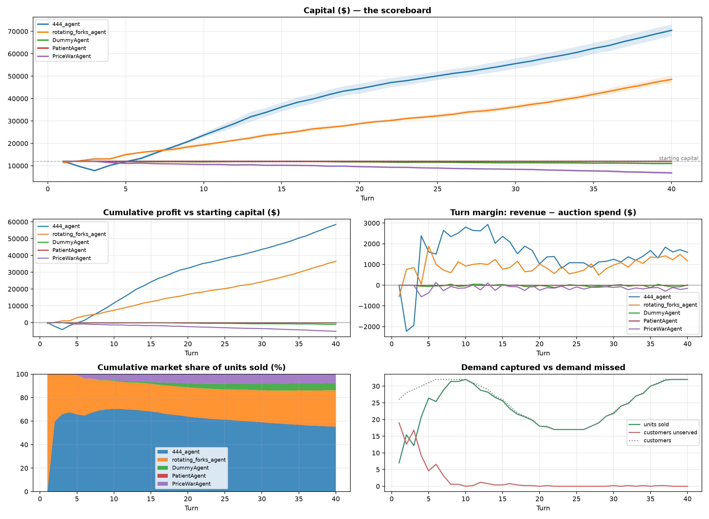
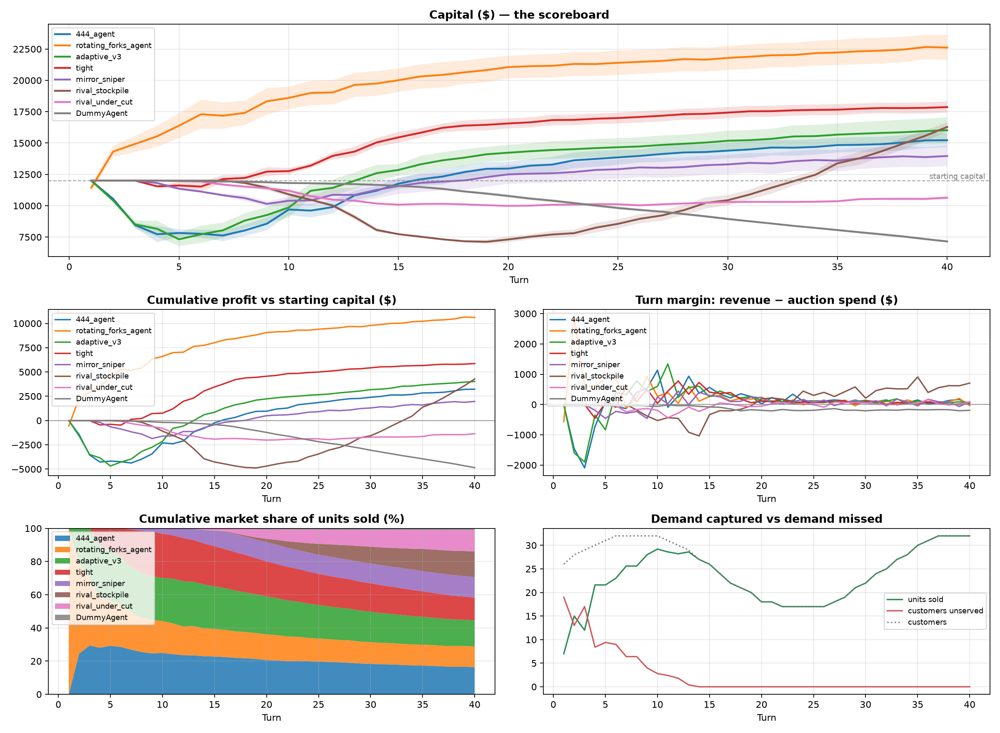

# Dynamic Market Exchange — Hackathon Bidding & Pricing Agents

Our solution repository for the **AIRIC × PMDS Dynamic Market Exchange (DME)** pricing & bidding hackathon (forked from [`AIRIC-Polimi/pmds-pricing-hackathon`](https://github.com/AIRIC-Polimi/pmds-pricing-hackathon)).

In the DME competition, autonomous agents manage a simulated electronics firm across sealed multi-turn markets—bidding for raw materials (`CHIP`, `DISPLAY`, `BATTERY`, `CASING`) in **pay-your-bid auctions**, planning recipe **production**, and setting **retail prices** for finished goods (`PHONE`, `LAPTOP`, `TABLET`, `SMARTWATCH`, `CONSOLE`) across heterogeneous customer segments (`BUDGET`, `MAINSTREAM`, `PREMIUM`). Final ranking is determined purely by **ending cash** (average rank across hidden scenarios; remaining inventory has zero terminal value).

Our final competition submissions live in [`submission/`](submission/) and [`src/dme_simulator/agents/`](src/dme_simulator/agents/):
- **`444_agent`** ([`submission/444_agent.zip`](submission/444_agent.zip) · [Strategy Guide](docs/444_agent.md)) — **Tight v7 + 5-Regime Market Detector**
- **`rotating_forks_agent`** ([`submission/rotating_forks_agent.zip`](submission/rotating_forks_agent.zip) · [Strategy Guide](docs/rotating_forks_agent.md)) — **Probe-Driven Cyclic Price Ladder & Lot-Aware Bidder**

---

## Submitted Agents Overview

Both submitted agents were engineered around three core empirical insights discovered in the simulator mechanics ([`docs/simulator_guide.md`](docs/simulator_guide.md)):

1. **Per-unit listing splitting ("lottery tickets"):** Customers sample stochastically among affordable listings (`price <= willingness_to_pay`), weighted toward cheaper offers. Submitting `N` separate `1`-unit `Listing` entries across a **price ladder** increases selection visibility while letting high-valuation `PREMIUM` buyers clear upper rungs.
2. **Pay-your-bid discipline:** Auction winners pay their *own* bid price, not a uniform clearing price. Overbidding drains working capital directly, so bid levels must rise only when recipes starve and decay quickly when lots fill.
3. **Zero holding cost vs. unknown horizon:** Because unsold stock carries over for free and match length is unknown, maintaining healthy shelf depth while avoiding below-cost price wars outperforms aggressive end-of-game liquidation.

| Feature | `444_agent` ([`Agent444`](src/dme_simulator/agents/444_agent/agent.py)) | `rotating_forks_agent` ([`RotatingForksAgent`](src/dme_simulator/agents/rotating_forks_agent/agent.py)) |
|---|---|---|
| **Architecture** | `Tight v7` core + runtime **5-regime detector** | Probe-driven anchor + cyclic ladder + rate-based shelf |
| **Regime Adaptation** | Switches parameters across *Costly*, *Pricing-only*, *Single-lot Auction*, *Standard (≤40 turns)*, and *Mature (>40 turns)* | Single adaptive policy with patience-based floor relaxation & optional `observe_all_transactions` log parsing |
| **Price Discovery** | `3.5x–4.5x` prior markup + widened `[0.75, 1.60]` ladder during first 6 turns; asymmetric up/down steps | `10.0x` initial markup + cheap **probe units** (`0.6x`, `0.4x`) on never-sold goods to snap anchor on first sale |
| **Price Ladder** | Continuous linear spacing across `[ladder_low, ladder_high]`, sorted **cheapest-first** | Discrete cyclic pattern `(1.0, 0.9, 1.12, 0.8, 1.25, 1.4)` ordered by **fill priority** |
| **Floor Protection** | Hard `1.3x` material-cost floor | Starts at `2.5x` cost; relaxes by `0.85x` after `3` zero-sale turns (down to `1.1x`) |
| **Competition Reading** | Counts rival finished stock & potential producers (`can_offer`), applies `1.15x` monopoly boost & penalizes crowded recipes (`comp_weight=2.0`) | Infers rival inventory drops (`rival_sold`) & holders, applies `1.12x` monopoly boost, cuts harder (`0.85x`) when rivals sell and we don't |
| **Auction Bidding** | Starvation-gated `bid_level`, adaptive cap (`cap_mode=2`, up to `60x` reserve), value-per-input cap, `50%–100%` budget share | `3x` opening bid, additive `+0.5` premium on underfill, `lot_aware` drop to `1.01x` reserve on growing lots, proportional `50%` budget cap |
| **Best Environments** | Standard, high-volume (`scaled_market`), `long`, and `costly` markets | Crowded 8-team fields, `short`, `capacity`-capped, and `tutorial_auction` markets |

For detailed line-by-line breakdowns, formulas, and trade-offs, read:
- [**`444_agent` Strategy & Architecture Guide**](docs/444_agent.md)
- [**`rotating_forks_agent` Strategy & Architecture Guide**](docs/rotating_forks_agent.md)
- [**`SOLUZIONE_IT.md`**](SOLUZIONE_IT.md) *(Italian development log & design notes)*

---

## Benchmark Results

Measured locally using [`tools/league.py`](tools/league.py) across the official scenarios (`config/*.yaml`) and our custom stress-test scenarios (`tools/scenarios/*.yaml`).

### 1. Submitted Agents vs. Official Built-in Bots (`--roster submitted`)
**60 games** (12 scenarios × 5 seeds: `1000–1004`), competing simultaneously (`444_agent`, `rotating_forks_agent`, `DummyAgent`, `PatientAgent`, `PriceWarAgent`):

| Agent | Avg Rank | Wins ( / 60) | Mean Capital | Min Capital |
|---|---:|---:|---:|---:|
| **`444_agent`** | **1.22** | **47** | **84,150** | 6,543 |
| **`rotating_forks_agent`** | **1.78** | **13** | **51,652** | **9,716** |
| `PatientAgent` | 3.53 | 0 | 14,250 | 5,000 |
| `DummyAgent` | 3.73 | 0 | 13,760 | 14 |
| `PriceWarAgent` | 4.73 | 0 | 10,900 | 65 |

- Together, `444_agent` and `rotating_forks_agent` swept **60 / 60 wins** and took 1st & 2nd place in every scenario.
- `444_agent` swept **5/5** in `default` (70,456 mean cash), `scaled_market` (436,914), `tutorial_pricing` (14,630), `costly` (61,319), `short` (36,228), `long` (127,966), `beta_high` (46,494), and `beta_low` (92,490).
- `rotating_forks_agent` swept **5/5** in `tutorial_auction` (14,834 vs. 6,773) and `capacity` (58,415 vs. 34,623), and won 2/5 in `cheap_wtp` (30,014 vs. 28,099).



*5-seed mean curves (±1 SE) on `config/default.yaml`: `444_agent` invests aggressively during `open_turns` (turns 1–3) before overtaking `rotating_forks_agent` around turn 7, while both agents capture >85% of total unit market share.*

### 2. Submitted Agents in a Crowded 8-Agent Field (`--roster submitted_field`)
**30 games** (6 scenarios × 5 seeds: `default`, `scaled_market`, `costly`, `scarce`, `short`, `long`) against strong experimental and synthetic rivals (`tight`, `adaptive_v3`, `mirror_sniper`, `rival_stockpile`, `rival_under_cut`, `DummyAgent`):

| Agent | Avg Rank | Wins ( / 30) | Mean Capital | Min Capital |
|---|---:|---:|---:|---:|
| `tight` | 2.20 | 9 | 35,682 | 441 |
| **`rotating_forks_agent`** | **2.27** | **12** | **32,942** | **2,003** |
| **`444_agent`** | 3.83 | 1 | 24,513 | 6,045 |
| `adaptive_v3` | 4.00 | 3 | 22,965 | 6,491 |
| `rival_stockpile` | 5.13 | 5 | 24,367 | 277 |
| `mirror_sniper` | 5.73 | 0 | 22,156 | 255 |
| `rival_under_cut` | 6.03 | 0 | 18,888 | 5,253 |
| `DummyAgent` | 6.80 | 0 | 15,056 | 2 |

- In crowded 8-player markets, `rotating_forks_agent` posted the highest win count (**12/30**, sweeping `default` 5/5 and `short` 5/5) thanks to its `50%` budget cap and probe-driven price discovery.
- `444_agent` preserved the highest worst-case capital floor (**6,045** minimum cash across all 30 games) and outperformed `rotating_forks_agent` in `costly` (`2.60` vs `4.80` avg rank) and `scarce` (`3.00` vs `3.20` avg rank).



*5-seed mean curves (±1 SE) on `config/default.yaml` (`submitted_field`): when aggressive `Tight`-family rivals bid up early inputs simultaneously, `rotating_forks_agent`'s `50%` budget cap avoids the early cash drawdown and wins 5/5 games.*

---

## Quick Start

### 1. Install Dependencies

Requires Python `3.11–3.13` and [`uv`](https://docs.astral.sh/uv/):

```bash
uv sync --locked --python 3.12
```

### 2. Verify Discovered Agents

```bash
uv run dme-sim --list-agents
```

Both `444_agent` and `rotating_forks_agent` are automatically discovered alongside the built-in and experimental bundles under `src/dme_simulator/agents/`.

### 3. Run Simulations & Benchmarks

Run a single simulation (interactive pygame window or headless):

```bash
uv run dme-sim --turns 40 --ui window --turn-delay 0.2
uv run dme-sim --config config/default.yaml --ui none
```

Run multi-seed league tournaments with [`tools/league.py`](tools/league.py):

```bash
# Head-to-head: 444_agent & rotating_forks_agent vs official built-in bots (with aggregated plots)
uv run python tools/league.py --roster submitted --seeds 5 --configs config/default.yaml config/scaled_market.yaml --plot-dir outputs/league_plots

# Crowded 8-agent competitive field
uv run python tools/league.py --roster submitted_field --seeds 5 --configs config/default.yaml config/scaled_market.yaml tools/scenarios/costly.yaml tools/scenarios/short.yaml

# Full 12-scenario sweep
uv run python tools/league.py --roster submitted --seeds 5 --configs config/default.yaml config/scaled_market.yaml config/tutorial_pricing.yaml config/tutorial_auction.yaml tools/scenarios/costly.yaml tools/scenarios/scarce.yaml tools/scenarios/short.yaml tools/scenarios/long.yaml tools/scenarios/capacity.yaml tools/scenarios/cheap_wtp.yaml tools/scenarios/beta_high.yaml tools/scenarios/beta_low.yaml
```

Run evolutionary parameter tuning for `rotating_forks_agent` via [`tools/evolve.py`](tools/evolve.py):

```bash
uv run python tools/evolve.py 0 4 8
```

---

## Repository Structure

```text
pmds-pricing-hackathon/
├── submission/                         # Final portal-ready submission ZIPs
│   ├── 444_agent.zip                   # Primary submission (Agent444)
│   └── rotating_forks_agent.zip        # Alternate submission (RotatingForksAgent)
├── src/dme_simulator/
│   ├── agents/
│   │   ├── 444_agent/agent.py          # Submitted: Tight v7 + 5-regime detector
│   │   ├── rotating_forks_agent/agent.py # Submitted: Probe + cyclic-ladder agent
│   │   ├── pepo_baseline/agent.py      # Simple safety parachute baseline
│   │   ├── tight/ & tight.py           # Tight v7 base engine
│   │   ├── adaptive_v2/ & adaptive_v3/ # Intermediate adaptive/regime prototypes
│   │   ├── mirror_*/ & competitive_rivals.py # 6 mirror-style benchmark bots
│   │   ├── rival_*/ & diverse_rivals.py      # 6 diverse-archetype benchmark bots
│   │   ├── builtin_bundles/            # Official DummyAgent, PatientAgent, PriceWarAgent
│   │   ├── base.py & loader.py         # Simulator agent interface & bundle loader
│   └── ...                             # Official DME simulator engine, CLI, UI, plots
├── tools/
│   ├── league.py                       # Multi-seed tournament runner & average-rank scorer
│   ├── evolve.py                       # Evolutionary hyperparameter search
│   ├── scenarios/                      # 8 stress-test market scenarios (costly, scarce, short, long, ...)
│   └── results/                        # Saved early tournament logs (official.txt, crowded.txt)
├── config/                             # Official YAML scenarios (default, scaled_market, ultralong, tutorials)
├── docs/
│   ├── images/                         # Aggregated 5-seed benchmark dashboard PNGs
│   ├── 444_agent.md                    # Deep dive: 444_agent strategy & mechanics
│   ├── rotating_forks_agent.md         # Deep dive: rotating_forks_agent strategy & mechanics
│   ├── simulator_guide.md              # Full DME rules, CLI flags, UI controls & submission spec
│   └── agent_interface.md              # Observation, GoodsConfig, and Decision API reference
├── benchmarks/                         # Simulation phase profiling harness
├── legacy/bizagent/                    # Pre-hackathon rule/LP/RL prototype (historical reference)
├── SOLUZIONE_IT.md                     # Italian technical notes & development log
└── pyproject.toml                      # Project configuration & uv dependencies
```

---

## Documentation Index

| Document | Description |
|---|---|
| [`docs/444_agent.md`](docs/444_agent.md) | Full architecture & parameter breakdown of `444_agent` (`Agent444`) |
| [`docs/rotating_forks_agent.md`](docs/rotating_forks_agent.md) | Full architecture & parameter breakdown of `rotating_forks_agent` (`RotatingForksAgent`) |
| [`docs/simulator_guide.md`](docs/simulator_guide.md) | Complete DME game mechanics, CLI options, UI controls, and portal submission rules |
| [`docs/agent_interface.md`](docs/agent_interface.md) | Reference for `Observation`, `GoodsConfig`, and `Decision` data types |
| [`SOLUZIONE_IT.md`](SOLUZIONE_IT.md) | Italian write-up of the hackathon insights, experiments, and tuning history |
| [`legacy/bizagent/FINAL_REPORT.md`](legacy/bizagent/FINAL_REPORT.md) | Statistical evaluation of our pre-rules `bizagent` prototype (LP + Bayesian demand) |
