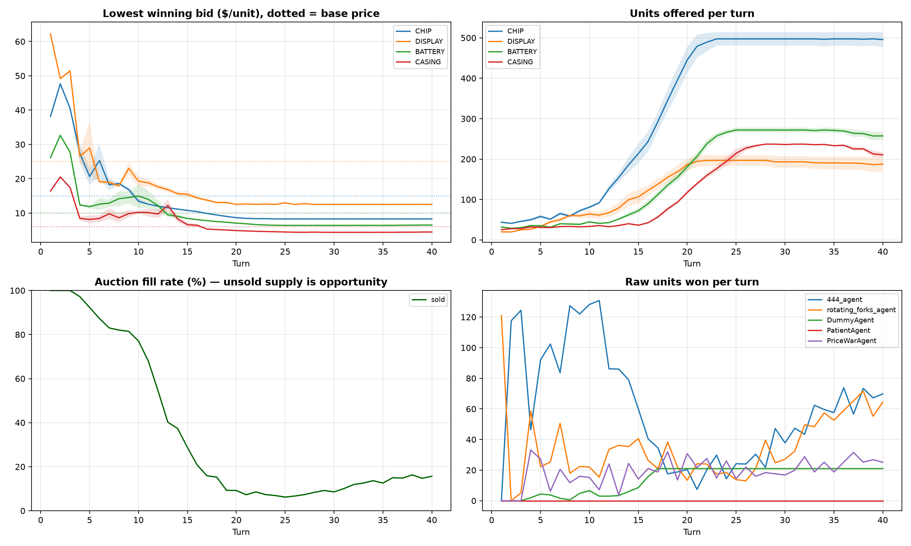
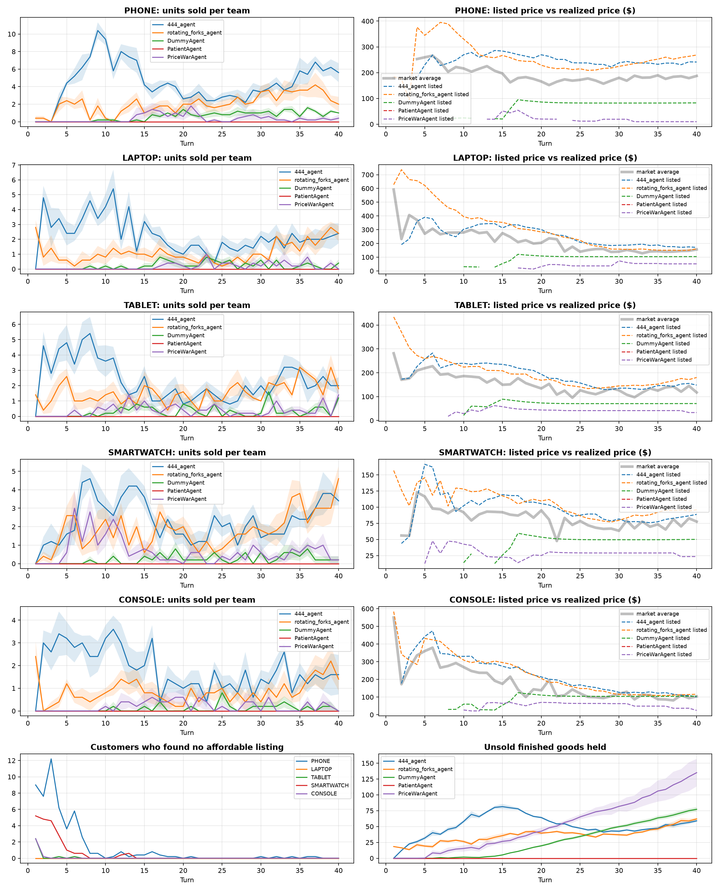

# `444_agent` (`Agent444`) — Multi-Regime Adaptive Strategy

**Files:**
- Local bundle: [`src/dme_simulator/agents/444_agent/agent.py`](../src/dme_simulator/agents/444_agent/agent.py)
- Submission archive: [`submission/444_agent.zip`](../submission/444_agent.zip) (contains `444_agent/agent.py`)

`444_agent` (`Agent444`) is our primary competition submission. It combines the **Tight v7** adaptive bidding/pricing/competition engine ([`tight/agent.py`](../src/dme_simulator/agents/tight/agent.py)) with a **5-regime runtime market detector** that dynamically reconfigures risk, stock depth, markup priors, and auction aggression on every turn using only public observations.

---

## 1. Core Design Philosophy

In the Dynamic Market Exchange (DME), four structural properties dominate strategy:

1. **Zero holding or labor costs:** Unsold raw materials and finished goods carry over across turns for free, and inventory at the end of the game is worth zero.
2. **Pay-your-bid sealed auctions:** Bidding above the clearing level burns pure cash on every unit won. You must bid *just* high enough to avoid starving profitable recipes.
3. **Probabilistic customer choice:** Customers draw a private valuation and sample among affordable listings with probability weighted toward lower prices. Splitting finished inventory into **1-unit listings across a price ladder** acts as multiple lottery tickets while capturing higher willingness-to-pay from `PREMIUM` buyers.
4. **Unknown horizon & hidden scenarios:** Official matches vary in length (short, standard, ultralong), input scarcity, reserve prices, and rival aggression. A single static parameter set fails when jumping between a `costly` market (`reserve_avg >= 25`) and an abundant `scaled` or `long` market.

---

## 2. Dynamic 5-Regime Switching

At the start of `_decide(state, gc)`, `Agent444` computes observable market signals from `state.auction_lots`, `state.inventory`, and `state.turn`:

- `reserve_avg`: mean `reserve_price` across active `state.auction_lots`
- `total_lot_qty`: total raw-material units available at auction this turn
- `len(lots)`: number of distinct material lots
- `initial_finished`: total finished goods currently held in `state.inventory`
- `turn`: current turn number (1-indexed)

It then selects one of five parameter profiles in priority order:

| Priority | Trigger Condition | Regime Intent | `prior_markup` | Ladder `[low, high]` | Stock (`min` / `cover` / `max`) | `budget_share` / `value_share` | `max_bid_mult` | Opening (`open_turns` / `open_stock` / `open_bid`) |
|---|---|---|---|---|---|---|---|---|
| 1 | `reserve_avg >= 25.0` | **Costly Materials** — preserve liquidity, avoid inventory bloat | `4.5` | `[0.65, 1.00]` | `2` / `3.0` / `40` | `0.65` / `0.70` | `5.0` | `0` / — / — |
| 2 | `initial_finished >= 10` and `total_lot_qty >= 200` and `reserve_avg <= 2.0` | **Pricing-Dominated / Abundant** — fast opening, full deployment | `3.5` | `[0.55, 1.20]` | `3` / `4.0` / `80` | `1.00` / `1.00` | `10.0` | `3` / `12` / `2.5` |
| 3 | `len(lots) == 1` and `total_lot_qty <= 50` and `reserve_avg >= 8.0` | **Auction-Constrained / Single Lot** — tight stock, restrained cap (`bid_start=2.0`, `bid_up=1.25`) | `4.0` | `[0.65, 1.00]` | `1` / `2.0` / `24` | `0.50` / `0.60` | `4.0` | `0` / — / — |
| 4 | `turn <= 40` | **Standard / Short Horizon** — aggressive early scale-up | `3.5` | `[0.50, 1.20]` | `3` / `4.0` / `80` | `1.00` / `1.00` | `10.0` | `3` / `12` / `2.5` |
| 5 | `turn > 40` | **Mature / Long Horizon** — deep buffer (`cover=6.0`), steady compounding | `4.0` | `[0.50, 1.10]` | `5` / `6.0` / `120` | `1.00` / `0.90` | `10.0` | `0` / — / — |

> [!NOTE]
> Because `reserve_avg` is re-evaluated every turn, if a normally cheap market experiences severe supplier price inflation (`reserve_avg >= 25.0`), `Agent444` automatically transitions into the defensive **Costly Materials** profile.

---

## 3. Turn-by-Turn Decision Pipeline

### Step 1 — Self-Identification & Transaction Parsing (`_identify`, `_decide`)
DME's `public_inventories` and `public_capital` expose all teams' holdings, while `auction_transactions` and `sales_transactions` are tagged by team ID (when `observe_all_transactions: true`, all teams' trades appear).
- `_identify` matches `state.capital` (within `1e-6`) and non-zero `state.inventory` entries against `state.public_inventories` and `state.public_capital` to identify `self.me` when uniquely distinguishable.
- Only newly appended transactions (`state.auction_transactions[self.seen_auction:]`, `state.sales_transactions[self.seen_sales:]`) belonging to `self.me` (or all if unidentified) are processed.
- Per-material realized unit cost is tracked via an EMA: `unit_cost[m] = 0.7 * old + 0.3 * tx.price`.

### Step 2 — Public Competition Awareness (`comp_aware = 1`)
Using `state.public_inventories`, `Agent444` inspects every rival team (`team != self.me`):
- `rival_units[g]`: total finished units of good `g` currently held by rivals.
- `rival_sellers[g]`: number of rivals that either hold `g` or hold enough raw materials in inventory to assemble at least 1 unit of `g` this turn (`can_offer`).

This feeds two decisions:
1. **Monopoly pricing boost:** If `turn > 1` and `rival_sellers[g] == 0`, no rival can offer `g` this turn, so `ref_price[g]` is multiplied by `mono_boost` (`1.15`) during listing generation.
2. **Competition-adjusted production priority:** Scarce raw materials are allocated to recipes ranked by:
   $$\text{score}(g) = \frac{\text{margin}(g) / \sum_{m} q_{g,m}}{1 + \text{comp\_weight} \cdot \frac{\text{rival\_units}[g]}{\max(1, \text{target}[g])}}$$
   with `comp_weight = 2.0`, steering scarce materials away from saturated goods.

### Step 3 — Asymmetric Reference Price Learning
For each finished good `g`:
- Initialized at `cost * prior_markup`, with `sales_rate[g]` updated via EMA (`0.7 * old + 0.3 * n_sold`).
- During `explore_turns` (`<= 6`), step sizes are amplified (`2.0x` upward, `1.5x` downward) and the ladder widens to `[early_low=0.75, early_high=1.60]`.
- Reference price `ref_price[g]` updates based on how the previous ladder sold:
  - **Sold out (`n_sold >= listed`):** `ref *= 1 + 2 * step_up` (strong demand -> climb fast)
  - **Top rungs sold (`max(sold) >= ref * up_thresh`, `up_thresh=0.9`):** `ref *= 1 + step_up` (`step_up=0.07`)
  - **Only lower rungs sold (`n_sold > 0`):** `ref *= 1 - 0.3 * step_down`
  - **Zero sales (`n_sold == 0`):** `ref *= 1 - step_down` (`step_down=0.15`)
- Clamped at `cost * min_markup` (`1.3`) so the agent never triggers a below-cost price war.

### Step 4 — Starvation-Gated Bidding & Adaptive Bid Cap (`cap_mode = 2`)
In a pay-your-bid auction, blind escalation wastes capital. `Agent444` gates bid increases on **actual recipe starvation**:
- For each material `m` bid last turn (`fill = won / asked`):
  - If `fill < 0.8` **and** at least one positive-margin good using `m` is below half its target stock (`inv[g] < max(1, target[g] // 2)`): `bid_level[m] = price * bid_up` (`1.5`, or `1.25` in single-lot auction mode).
  - If `fill < 0.8` without starvation: hold `bid_level[m] = price`.
  - If `fill >= 0.8`: decay `bid_level[m]` by `0.85` on full fill (`>= 0.999`) or `0.94` on partial fill, rapidly shedding unnecessary overpayment.
- **Adaptive Bid Cap (`cap_mode = 2`):** `self.cap_mult` starts at `max_bid_mult` and grows by `cap_grow` (`1.25`, up to `cap_limit = 60.0`) only when **both** an auction bid was underfilled (`won < 0.8 * asked`) **and** at least half of listed goods sold out (`goods_sold_out >= 0.5 * goods_listed`). It shrinks (`* 0.9`) when finished stock exceeds `2 * cover_turns`.
- **Value Cap:** Each bid is strictly capped by `value_share` of the highest-valued recipe output per input unit (`self.value_share * ref_price[g] / total_inputs`), preventing paying more for materials than the finished good is worth.
- **Total Spend Cap:** Planned bids are capped sequentially by `state.capital * self.budget_share`.

### Step 5 — Production & Continuous Cheapest-First Ladder
- Target stock per good: `min(max_stock, round(sales_rate[g] * cover_turns) + effective_min_stock)`.
- `AssemblyOrder` requests are emitted in descending `score(g)` order.
- Every unit of planned finished supply (`inv[g] + need[g]`) is listed as an individual **1-unit `Listing`** linearly spaced across `[low, high] * ref` (with `mono_boost` if uncontested), floored at `good_cost[g] * min_markup`.
- Listings are emitted **cheapest-first** (`sorted(prices)`). Because the simulator truncates listings sequentially if production falls short of `need[g]`, sorting cheapest-first guarantees that cheap, high-probability listings survive while expensive top-rung listings drop if materials were scarce.
- A `_fallback` handler wraps `_decide` so any unexpected error still lists existing inventory at `ref_price`.

---

## 4. Visualized Auction & Sales Behavior

*Auction dynamics (`submitted`, 5 seeds on `config/default.yaml`): `444_agent` captures high early material volume during `open_turns`, then lets `bid_level` decay as supplier stocks expand and reserve prices fall.*

*Sales & pricing (`submitted`, 5 seeds on `config/default.yaml`): per-unit ladder pricing keeps `444_agent`'s realized prices aligned with market willingness-to-pay across all five goods while avoiding `PriceWarAgent`'s margin collapse.*

---

## 5. Strengths & Trade-offs

- **Where `444_agent` excels:** Dominant against standard and baseline opponents across diverse scenarios (`47/60` wins, `1.22` average rank against `rotating_forks_agent`, `DummyAgent`, `PatientAgent`, and `PriceWarAgent`), especially in high-volume (`scaled_market.yaml`), long-horizon (`long.yaml`), and expensive-input (`costly.yaml`) markets.
- **Trade-offs vs `rotating_forks_agent`:** Because `444_agent` commits up to `100%` of capital (`budget_share = 1.0`) in standard/short regimes and uses a steeper `bid_up = 1.5`, in very crowded 8-player competitive fields where multiple `Tight`-family bots bid up inputs simultaneously, it can occasionally overpay for inputs compared to `rotating_forks_agent`'s `50%` budget cap and probe-driven floor relaxation.
