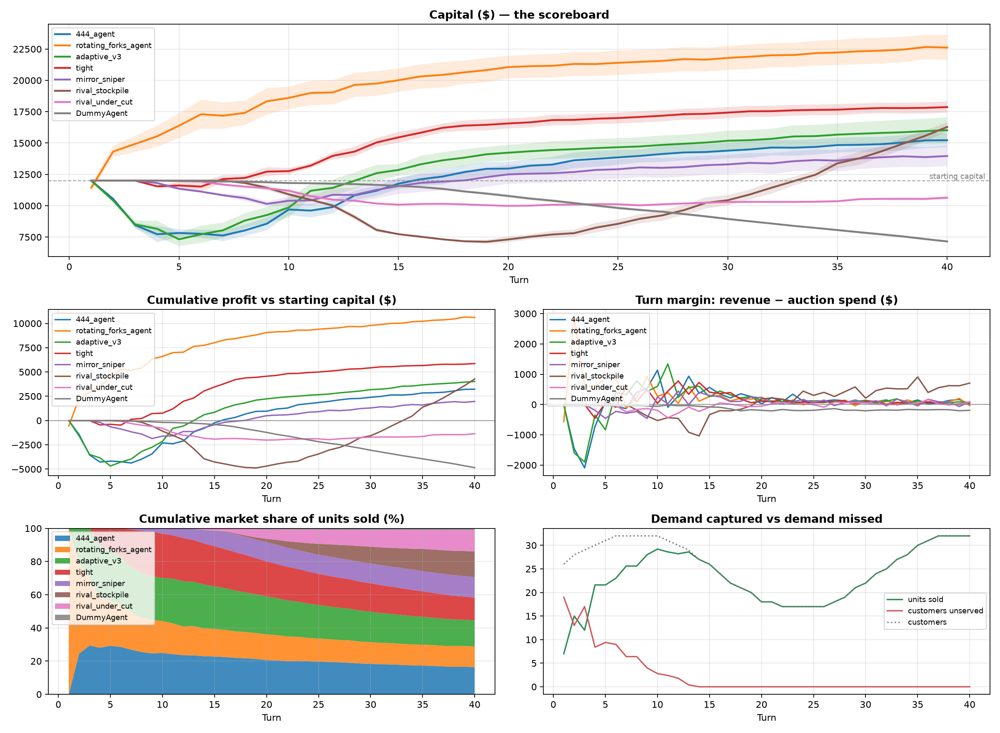

# `rotating_forks_agent` (`RotatingForksAgent`) — Probe & Cyclic-Ladder Strategy

**Files:**
- Local bundle: [`src/dme_simulator/agents/rotating_forks_agent/agent.py`](../src/dme_simulator/agents/rotating_forks_agent/agent.py)
- Submission archive: [`submission/rotating_forks_agent.zip`](../submission/rotating_forks_agent.zip) (contains `rotating_forks_agent/agent.py`)

`rotating_forks_agent` (`RotatingForksAgent`) is our second submitted agent—an independently tuned, adaptive price-ladder architecture descended from our custom `bizagent` design and refined via evolutionary search ([`tools/evolve.py`](../tools/evolve.py)) and multi-roster leagues ([`tools/league.py`](../tools/league.py)).

---

## 1. Core Design Philosophy

While `444_agent` uses continuous linear ladders and regime switching, `RotatingForksAgent` focuses on **fast market-price discovery**, **lottery-ticket cyclic ladders**, **discipline against price wars**, and **crowded-market resilience**:

1. **Start high, probe low:** Begin with a `10.0x` material-cost anchor to extract maximum surplus from uncontested early `PREMIUM` buyers, while simultaneously attaching **probe units** (`0.6x` and `0.4x` of anchor) on never-sold goods to immediately discover customer willingness-to-pay.
2. **Adaptive floor relaxation:** Maintain a high price floor (`2.5x` cost) to avoid destructive price wars, but relax it step-by-step (`* 0.85` after `floor_patience = 3` zero-sale turns, down to `floor_abs = 1.1x`) if a market simply has low willingness-to-pay.
3. **Priority-ordered cyclic ladder:** List each unit individually using a discrete multiplier cycle `(1.0, 0.9, 1.12, 0.8, 1.25, 1.4)` where list order acts as fill priority if production comes up short.
4. **Proportional budget & slack detection:** Cap total auction spend at `50%` of capital (`budget_frac = 0.5`) with proportional scaling across materials, and detect uncontested supplier lots (`lot_aware`) to drop premiums to `1%` above reserve.

---

## 2. Turn-by-Turn Decision Pipeline

### Step 1 — Team Identification & Full-Log Separation (`_identify`, `_is_mine`)
Scenarios may set `observe_all_transactions: true`, mixing all teams' trades into `sales_transactions` and `auction_transactions`.
- `_identify` first tries matching exact `capital` and `inventory` against `public_capital` / `public_inventories`.
- If multiple teams start with identical state (e.g., turn 1–2), it falls back to **price fingerprinting**: checking which candidate team traded at prices matching `self.my_list_prices` or `self.my_bid_prices`.
- Once separated, rival sales (`rival_prices`) are kept as market intelligence rather than discarded.

### Step 2 — Rival Shelf & Sell-Through Tracking
Even when `observe_all_transactions` is `false`, `RotatingForksAgent` infers rival sales from public inventory drops between turns:
- `rival_stock[g]`: total finished units held by other teams.
- `rival_holders[g]`: count of rival teams currently holding good `g`.
- `rival_sold[g]`: estimated units sold by rivals, taking the maximum of `(public_inventory_drop - my_inventory_drop)` and `len(rival_prices[g])`.

### Step 3 — Probe-Driven Anchor & Floor Adaptation
Each finished good `g` maintains an `anchor[g]` and an adaptive floor multiplier `floor_mult[g]` (starting at `min_markup = 2.5`):
- **Initialization:** `anchor[g] = max(floor, cost[g] * 10.0)`.
- **First-sale jump (`first_sale and probes`):** The moment a good records its very first sale, the anchor snaps directly to `max(sold_prices)` (never below `ref * 0.90` if it sold at or above the anchor), and `floor_mult[g]` adapts downward if customers paid below `2.5x` cost (`max(1.1, top / cost * 0.95)`).
- **Subsequent turns:**
  - **Sold at or above anchor (`price >= ref * 0.999`):** Climb by `mono_up` (`1.12`) if `rival_stock[g] == 0` (monopoly), else `up` (`1.05`).
  - **Sold only below anchor:** Trim gently by `hold_down` (`0.95`).
  - **Zero sales while rivals sold (`rival_sold[g] > 0`):** Cut harder by `rival_down` (`0.85`), recognizing we are priced above active competitors.
  - **Zero sales across the board:** Cut by `down` (`0.90`).
  - **Full market log override (`use_market_log`):** When `observe_all_transactions` exposes `rival_prices[g]` and we sold nothing, clamp `anchor[g]` down to `min(anchor[g], max(rival_prices[g]))`.
- **Patience-based floor relaxation:** If `streak >= 3` zero-sale turns while anchored at the floor (`anchor <= cost * fm * 1.01`), multiply `fm` by `0.85` (bounded by `floor_abs = 1.1`).

### Step 4 — Rate-Based Shelf Sizing & Competition-Weighted Production
- **Target stock (`stock_mode = "rate"`):**
  - Before any sales of `g` (`total_sold[g] == 0`): hold `start_stock = 10` units on the shelf so early customers are never missed.
  - Once `g` has sold: `target[g] = min(30, round(2 + 5.0 * rate[g]))`, where `rate[g]` is an EMA (`rate_alpha = 0.3`) of recent unit sales.
- **Recipe priority (`value`):**
  $$\text{value}(g) = \frac{(\text{anchor}[g] - \text{cost}[g]) / \text{input\_units}}{1 + 0.15 \cdot \text{rival\_holders}[g]}$$
  Recipes with higher margin per raw-material unit and fewer competing sellers get first claim on shared materials like `CHIP`.

### Step 5 — Lot-Aware Auction Bidding & Proportional Capital Scaling
For each material lot:
- **Opening turn (`start_premium = 2.0`):** Bids `3.0x` reserve on the first turn seen to secure early inventory before rivals ramp up.
- **Feedback loop:**
  - If previous bid was partially filled or unfilled (`won < requested`): increase `premium` by `+0.5` up to `premium_cap = 3.0`.
  - Otherwise, decay `premium` toward `bid_premium` (`0.1`): `0.1 + (prem - 0.1) * 0.6`.
  - **Slack lot detection (`lot_aware = True`):** When filled and the supplier lot quantity grew since last turn (`lot.quantity > prev_lot`), demand is below supply; `premium` immediately drops to `slack_premium = 0.01` (`1%` above reserve) to stop overpaying in pay-your-bid auctions.
- **Proportional budget cap (`budget_frac = 0.5`):** Instead of exhausting budget sequentially in dictionary order, if `planned_cost > 0.5 * capital`, all material bid quantities are scaled proportionally by `budget / planned_cost`.

### Step 6 — Cyclic Discrete Price Ladder & Probe Units
For `n = inv[g] + need[g]` total planned units:
- Prices cycle through `ladder = (1.0, 0.9, 1.12, 0.8, 1.25, 1.4)` multiplied by `anchor[g]` and clamped to `floor`:
  - Unit `0` lists at `1.00 * anchor` (always survives partial production)
  - Unit `1` lists at `0.90 * anchor`
  - Unit `2` lists at `1.12 * anchor`
  - ...and so on.
- If `turn > 1` and `total_sold[g] == 0`, indices `1` and `2` are replaced with cheap **probe units** at `0.6 * anchor` and `0.4 * anchor` (floored at `1.1 * cost`) to rapidly locate buyer willingness-to-pay without sacrificing unit `0`'s high anchor offer.
- With `split_listings = True`, each unit is emitted as a separate `Listing(good, 1, price)`.

---

## 3. Visualized Crowded-Market & Price-Discovery Behavior

*5-seed mean curves (±1 SE) in the 8-agent `submitted_field` roster on `config/default.yaml`: `rotating_forks_agent` stays cash-positive from turn 2 onward by capping auction spend at `50%` of capital and using probe units to discover clearing prices immediately.*

---

## 4. Strengths & Trade-offs

- **Where `rotating_forks_agent` excels:**
  - **Crowded competitive fields:** In our 8-player `submitted_field` league (30 games across 6 scenarios against `tight`, `adaptive_v3`, `mirror_sniper`, `rival_stockpile`, `rival_under_cut`, `DummyAgent`), `rotating_forks_agent` won **12 / 30 games** (`2.27` average rank, `32,942` mean capital), sweeping `default.yaml` (`5/5`) and `short.yaml` (`5/5`).
  - **Auction-only & capacity-constrained scenarios:** Swept `tutorial_auction.yaml` (`5/5`) and `capacity.yaml` (`5/5`) against `444_agent` and official bots, because proportional `50%` budget scaling and `lot_aware` slack detection prevent overpaying when production or demand is capped.
- **Trade-offs vs `444_agent`:**
  - The `30`-unit `target_max` shelf cap and `50%` `budget_frac` limit upside in very large/long/high-volume scenarios (`scaled_market.yaml`, `long.yaml`), and the `10.0x` initial markup can lose ground early in `costly.yaml` if cheap rivals undercut before `floor_patience` triggers.
